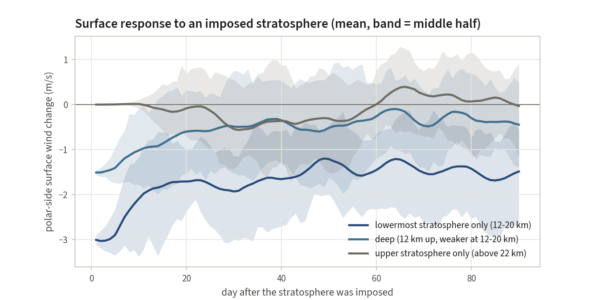
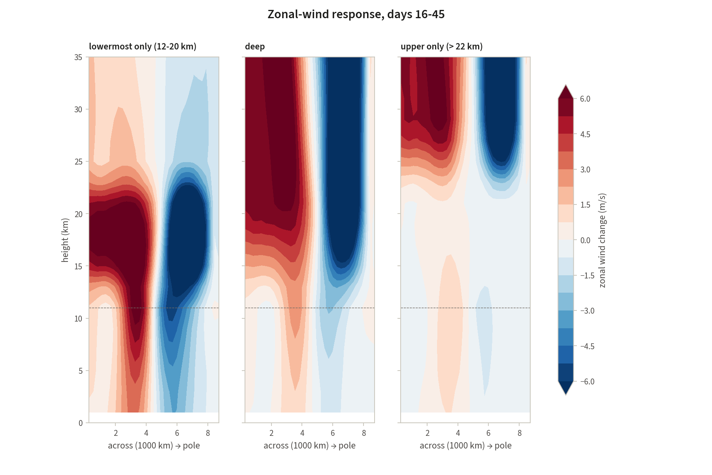
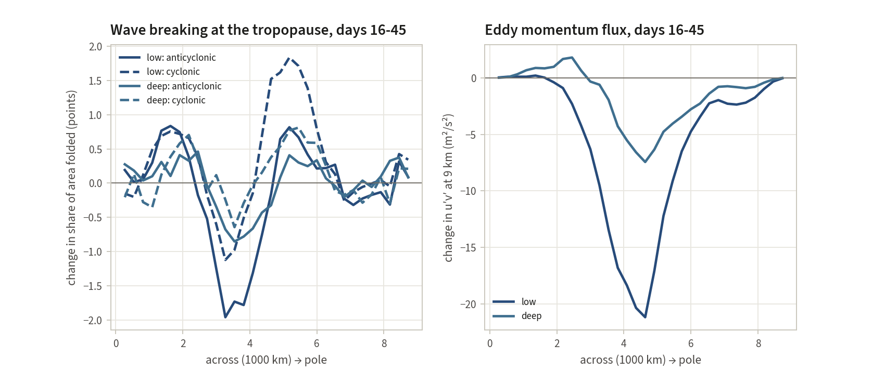
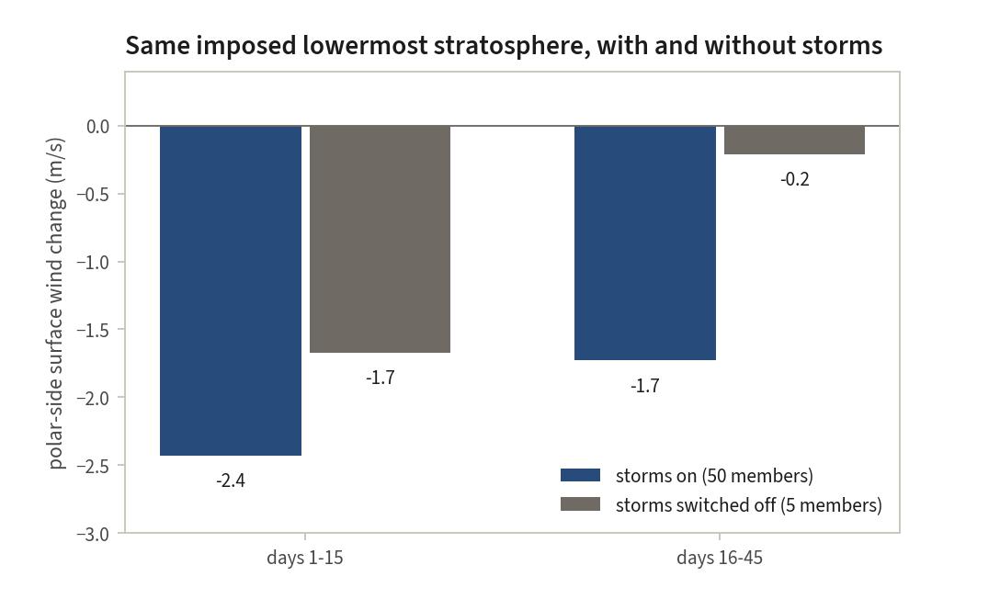
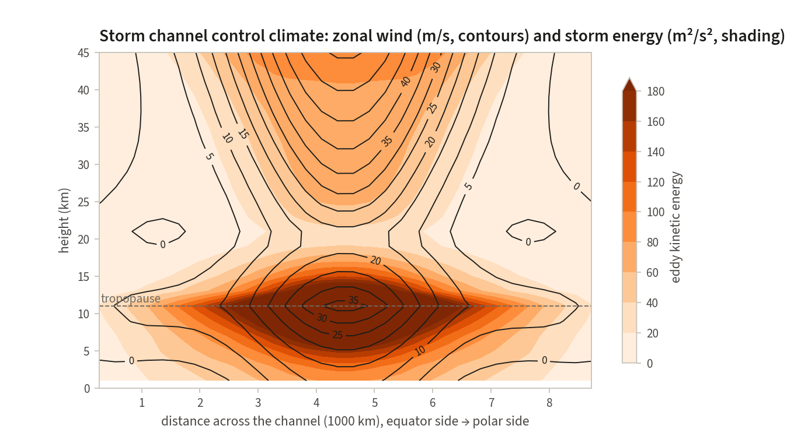
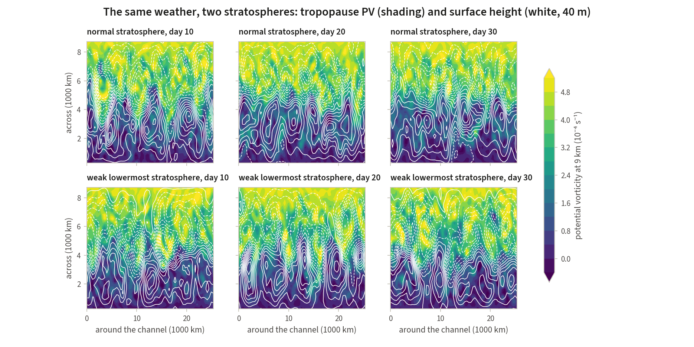

# qg-channel

A 30-level quasi-geostrophic channel, from the ground to 60 km, that makes its own storms. It is built for one kind of
experiment: impose a stratosphere, leave the troposphere and every eddy free, and measure what the storms do.

The question behind it is how a sudden stratospheric warming reaches the surface, when it does. The zonal-mean
stratosphere is nudged toward a chosen state above about 12.5 km, and each run is paired with a run whose stratosphere
stays normal, starting from the same weather. The difference between the two is the stratosphere's effect and nothing
else.



## What it finds so far

- **Only the lowermost stratosphere matters.** A polar wind anomaly of −20 m/s confined to 12–20 km (roughly 200–100 hPa)
  shifts the tropospheric jet 250–360 km toward the equator and cuts the polar-side surface westerlies by 1.4–2.4 m/s
  for 90 days, in 94–100 % of 50 runs. The same anomaly confined above 22 km does essentially nothing at the surface.
- **The storms carry it.** With the eddies switched off, the same imposed anomaly gives −1.7 m/s at first but only −0.2
  m/s by weeks 3–6: friction erases the balanced response. With storms it stays at −1.7 m/s.
- **Through wave breaking.** Anticyclonic (SW–NE) breaking at the tropopause falls in the jet core, cyclonic (NW–SE)
  breaking rises on its polar side, and the eddy momentum flux on the jet's poleward flank turns equatorward. That flux
  is what holds the jet south. The changes in the folded area are modest (a few per cent of it) but consistent across
  runs.

| imposed −20 m/s at | days 1–15 | days 16–45 | days 46–90 |
|---|---|---|---|
| 12–20 km only | −2.4 m/s (100 % of runs agree) | −1.7 (96 %) | −1.4 (94 %) |
| 12 km and up (weaker at 12–20 km) | −1.2 (90 %) | −0.5 (70 %) | −0.4 (62 %) |
| above 22 km only | 0.0 (50 %) | −0.3 (62 %) | 0.0 (40 %) |

Polar-side surface westerlies, experiment minus paired reference, mean of 50 runs; "agree" is the share of runs with the
sign of the mean.





## The model

Prognostic potential vorticity of the departure from a background flow U(z):

    q = ∇²ψ + (f0² / ρ) ∂z(ρ / N² ∂z ψ)
    ∂q/∂t + (U + u) ∂x q + v (Qy + ∂y q) = −S_α(ψ − ψ_eq) − r(z) ∇²ψ − sponge − walls − hyperdiffusion

- Log-pressure height z = H ln(p0/p), 30 layers to 60 km, N² 1.2×10⁻⁴ s⁻² in the troposphere and 4.5×10⁻⁴ above an
  11 km tropopause.
- The stretching operator is layered with zero flux through the ground and the lid, so the background PV gradient
  Qy = β − S·U carries the ground and lid temperature gradients as PV sheets: the baroclinic instability that makes the
  storms.
- Periodic in x (one latitude circle at 50°N), walls at y = 0 and 9000 km (sine series), so inverting q for ψ is a
  division in (vertical mode, l, k). 64 × 32 × 30 grid, third-order Adams–Bashforth, 2/3-rule dealiasing.
- Newtonian cooling toward a winter equilibrium (40 days in the troposphere, 45 days above the tropopause falling to 8
  days at the lid), Rayleigh friction (1 day⁻¹ at the ground, zero at 2 km), a sponge above 50 km, damping zones along
  both walls.
- Control climate: a 31 m/s jet at 10 km, storm-track eddy energy 166 m²/s² (ERA5 winter storm tracks: 100–150),
  surface westerlies of 12 m/s, and an annular mode explaining half the variance that decays in 6 days, close to ERA5.




Limits: a flat channel with no mountains, so there are no stationary planetary waves; the channel-mean wind is fixed by
the walls, so the response shows up as a jet shift; balance ties wind and temperature together, so they cannot be
imposed separately.

## Running it

```
pip install -e ".[scripts]"
python scripts/run_control.py --days 2200                 # ~30 min: runs/control.npz + runs/restarts.npy
python scripts/run_imposed.py ref                         # 50 runs x 90 days, ~75 min on one core
python scripts/run_imposed.py low                         # also deep, shallow; --amplitude, --storms-off, --dt
python scripts/analyze.py low                             # response table -> runs/response.csv
python scripts/run_event.py anomaly.nc 2021 --dt 600      # an observed stratosphere (see the script's help)
```

Runs that impose a strong anomaly reaching above 20 km for months need `--dt 600` (pair them with a `ref` at the same
step). The control state and restarts used for the results above are attached to the `control-v1` release; put them in
`runs/` to skip the spin-up.

`pytest` checks the numerics against exact results: the PV inversion round trip, the y-derivative, and the phase
speed of a free Rossby wave (matched to 1 part in 10⁶).

## Observations

`observations/igra_arctic.py` (run by the `igra-arctic` workflow, published as a release) reads every October–April
sounding from long-record Arctic radiosonde stations in NOAA's Integrated Global Radiosonde Archive and keeps the
lower-stratosphere temperatures and winds, the WMO tropopause, and the strength of the inversion just above it. The
model's mechanism runs through the tropopause PV gradient, so the sharpness of the observed tropopause after sudden
warmings is the direct test.

## Licence

MIT.
